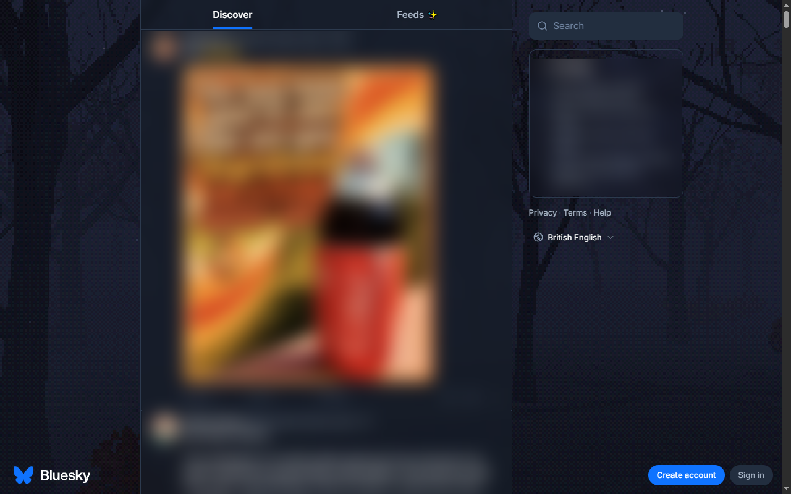

# tbsky

Bluesky apps from TechyBen.

| App | What it is |
|---|---|
| [skytreeone](https://github.com/TechyBen/skytreeone) | Browser extension: a quiet PS1-style procedural forest ([playtreeone](https://github.com/TechyBen/playtreeone)) behind bsky.app, muted by default. Posts from people you follow are birds. (An older copy is in [skytreeone/](skytreeone/) here.) |
| [fightskyone](https://github.com/TechyBen/fightskyone) | Browser extension: a PS1-style sky behind bsky.app and a jet to fly in it. Posts are other jets: lock on to see who posted, and a missile burst opens the post. |
| [cathodeskyone](https://github.com/TechyBen/cathodeskyone) | Browser extension: an old image-processing terminal behind bsky.app. Posts are bars of likes, replies and reposts, pictures come out in low-res black and white, and a simulated voice ([CHIMERA](https://github.com/jamesondh/chimera-vocal-synth)) reads them aloud. |

Each extension puts a scene behind the page, so keep one switched on at a time.

