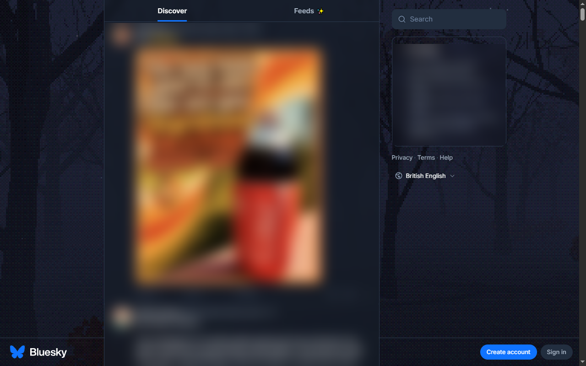

# skytreeone

A browser extension that puts the [playtreeone](https://github.com/TechyBen/playtreeone) PS1-style forest behind [Bluesky](https://bsky.app). The scenes, sun, moon, stars and fog are the same as the treeps1 screensaver, rendered quietly behind your feed. Sound is off by default.



## Install (unpacked)

```bash
git clone --recurse-submodules https://github.com/TechyBen/tbsky
cd tbsky/skytreeone
python build.py
```

Then in Chrome or Edge, open `chrome://extensions`, turn on **Developer mode**, click **Load unpacked** and pick `skytreeone/dist/skytreeone`. Open bsky.app.

## Settings (toolbar popup)

| Setting | Default | |
|---|---|---|
| Forest behind Bluesky | on | Switching off restores Bluesky exactly |
| Sound | off | Wind and birds. Browsers only start audio after a click, so it starts on your next click on Bluesky, and pauses while the tab is hidden |
| Volume | 40% | |
| Feed panel | 70% | Opacity of the blurred panel behind the feed |
| Blur | 6 px | |
| Minutes per scene | 15 | Fog rolls in, a new scene loads behind it |
| Pixel height | 240 | Render height; lower is chunkier and lighter on the GPU |
| Frame cap | 30 fps | |

## How it works

- `ext/content.js` adds a fixed, click-through `<iframe>` under everything on bsky.app. It loads the extension's own copy of the playtreeone page in screensaver mode (`tree/index.html?saver&audio=0…`).
- Bluesky paints its page colour inline on many nested panels. Each panel whose colour equals the page colour is made transparent, plus the navigation screens' near-black backdrop. A `MutationObserver` keeps up as you scroll and navigate. Fixed overlays like the image viewer are left alone.
- A translucent, blurred panel in the page colour sits behind the feed column, and a faint veil (stronger on the light theme) plus a soft text halo keeps the side columns readable.
- `build.py` copies `web/` (playtreeone, a git submodule) into the extension. Extensions can't load code from a CDN, so three.js and lil-gui are vendored in `vendor/` and the bare imports are rewritten to local paths.
- Nothing is sent anywhere: no login, no account access, no analytics. Live weather is off. See [PRIVACY.md](PRIVACY.md).

After changing playtreeone: `git submodule update --remote web`, then `python build.py`.

## Testing without installing

`python tools/serve.py` serves `dist/skytreeone` with the headers a public page needs to load scripts from localhost. Inject `content.css`, `settings.js` and `content.js` into bsky.app with `window.SKYTREE_TEST_BASE = 'http://localhost:8174/tree/index.html'` set first, and the content script runs with default settings (`window.__skytreeTest.apply({...})` changes them).

## Licences

playtreeone and its star data (d3-celestial, BSD 3-clause), three.js (MIT) and lil-gui (MIT). See `dist/skytreeone/licenses/` after building.
